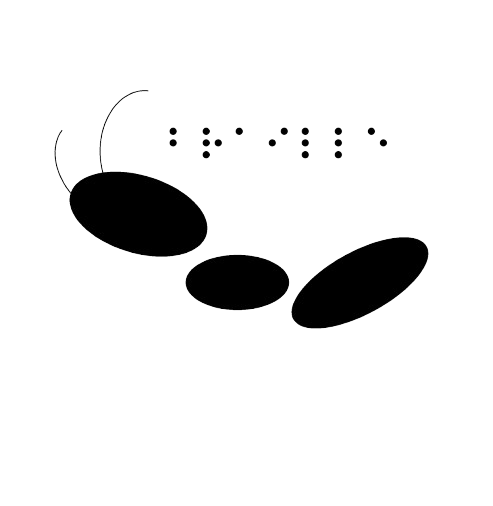

# 🙏 Thanks
## This project exists thanks to the support, collaboration, and tools provided by many people and communities.
### My sincere appreciation goes to:
### Developers Who Came Before
- For building the foundations, tools, and knowledge that allow new accessibility technologies to exist today.
### João Victor Nagao
- For contributing to the development of new accessibility tools and helping expand the possibilities of this project.
### Koyama Rumi
- For helping with the marketing and presentation of the tool.
### Nagao Yuji
- For creating and maintaining BrailleBase, designing its architecture, and developing its core features with a focus on accessibility and education.

### Font Base
        Japanese
        https://www.mhlw.go.jp/tenji/index.html
        https://www.nittento.or.jp/images/pdf/information/braille_lists.pdf
        https://www.hokuten.com/document_gojuon.html#mark3
        https://www.edvisionservices.org/Formsupdated/PDFForms/UEB_chart_and_reference_guide.pdf
        https://chinhphu.vn/default.aspx?pageid=27160&docid=198030
        Portuguese
        https://fisicaembraille.ufpr.br/alfabeto-braille/
        https://lepix.org/braillept/
        https://www.infoescola.com/portugues/braile/
        https://pt.wikipedia.org/wiki/Alfabeto_portugu%C3%AAs
        https://www.questoesestrategicas.com.br/resumos/ver/numeros-sinais-matematicos-unidades-monetarias-e-de-medidas
        https://www.deficienciavisual.pt/txt-grafiabrailleLP.htm
        https://www.gov.br/ibc/pt-br/pesquisa-e-tecnologia/materiais-especializados-1/livros-em-braille-1/o-sistema-braille-arquivos/grafia-braille-para-a-lingua-portuguesa-pdf.pdf
        https://www.gov.br/ibc/pt-br/pesquisa-e-tecnologia/materiais-especializados-1/livros-em-braille-1/o-sistema-braille-arquivos/codigo-matematico-unificado-para-a-lingua-portuguesa-cmu-pdf.pdf/@@display-file/file
        https://www.edvisionservices.org/Formsupdated/PDFForms/UEB_chart_and_reference_guide.pdf
        https://chinhphu.vn/default.aspx?pageid=27160&docid=198030
        https://apadev.org.br/pages/downloads/AlfabetoBraille.pdf
        Arabic
        https://braille.mada.org.qa/braille-module-1-reference/?lang=en
        https://www.edvisionservices.org/Formsupdated/PDFForms/UEB_chart_and_reference_guide.pdf
        https://chinhphu.vn/default.aspx?pageid=27160&docid=198030
        English
        https://www.pharmabraille.com/pharmaceutical-braille/the-braille-alphabet/
        https://iceb.org/wp-content/uploads/2025/10/Rules-of-Unified-English-Braille-2024.pdf
        https://brailleaustralia.org/wp-content/uploads/2025/02/Rules-of-Unified-English-Braille-2024-1.pdf
        https://www.brailleauthority.org/alphabet/alphabet.pdf
        https://www.brailleart.org/pdf/Brailleart-Braille-Alphabet-English-Language-Letter.pdf
        https://braillecomicsclub.substack.com/p/the-unified-english-braille-alphabet
        https://braille.codes/tables.html
        https://www.edvisionservices.org/Formsupdated/PDFForms/UEB_chart_and_reference_guide.pdf
        https://chinhphu.vn/default.aspx?pageid=27160&docid=198030
        Viet
        https://chinhphu.vn/default.aspx?pageid=27160&docid=198030
        https://donghanhviet.vn/chu-noi-nhung-cham-nho-ki-dieu-doi-voi-nguoi-khiem-thi/
        https://giaoduc.net.vn/chu-noi-cau-noi-giup-nguoi-khiem-thi-tiep-can-tri-thuc-hoa-nhap-xa-hoi-post248262.gd
        https://hanoidep.vn/ky-hieu-chu-noi/
        https://vi.wikipedia.org/wiki/H%E1%BB%87_th%E1%BB%91ng_ch%E1%BB%AF_n%E1%BB%95i_ti%E1%BA%BFng_Vi%E1%BB%87t
        https://thuvienphapluat.vn/van-ban/Giao-duc/Thong-tu-15-2019-TT-BGDDT-Quy-dinh-chuan-quoc-gia-ve-chu-noi-Braille-cho-nguoi-khuyet-tat-424614.aspx
        https://www.pharmabraille.com/pharmaceutical-braille/the-braille-alphabet/
        https://iceb.org/wp-content/uploads/2025/10/Rules-of-Unified-English-Braille-2024.pdf
        https://brailleaustralia.org/wp-content/uploads/2025/02/Rules-of-Unified-English-Braille-2024-1.pdf
        https://www.brailleauthority.org/alphabet/alphabet.pdf
        https://www.brailleart.org/pdf/Brailleart-Braille-Alphabet-English-Language-Letter.pdf
        https://braillecomicsclub.substack.com/p/the-unified-english-braille-alphabet
        https://braille.codes/tables.html
        https://www.edvisionservices.org/Formsupdated/PDFForms/UEB_chart_and_reference_guide.pdf
        https://grokipedia.com/page/vietnamese_braille
        Italian
        https://www.bibliotecaciechi.it/pagina_base_con_docu/il-nuovo-codice-braille-italiano/
        https://ciechiescuola.it/
        https://it.wikipedia.org/wiki/Alfabeto_italiano
        French
        https://pt.wikipedia.org/wiki/%C5%92
        https://braille-translator.com/fr/blog/alphabet-braille-francais/
        https://en.wikipedia.org/wiki/French_Braille
        https://www.pharmabraille.com/braille-codes/france-braille-code/
        https://liblouis.io/braille-specs/french/table_braille_informatique_tbfr2007.pdf
        https://www.universalis.fr/encyclopedie/braille/3-enseignement-du-braille/
        https://braillechart.com/pt/alphabet/u-trema/
        https://www.avh.asso.fr/nos-solutions/tout-savoir-sur-le-braille/lecriture-braille
        https://en.wikipedia.org/wiki/%C3%86
        Korean
        https://stock.adobe.com/jp/images/korean-braille-alphabet/407129011
        https://newsteacher.chosun.com/site/data/html_dir/2013/07/30/2013073067004.html
        https://en.wikipedia.org/wiki/Korean_Braille
        https://www.korean.go.kr/braille/common/greeting.do
        https://www.hancom.com/
        https://ko.wikipedia.org/wiki/%ED%95%9C%EA%B8%80
        https://www.ohmynews.com/NWS_Web/View/at_pg.aspx?CNTN_CD=A0000832634
        https://wiki.arcsnet.dev/content/wikipedia_en_all_maxi_2026-02/Korean_Braille?utm_source=chatgpt.com
        https://www.korean.go.kr/common/download.do%3Bfront%3DE83E929C9121645D3A123656393CDADE?c_file_name=ef118806-5660-4120-be1e-20388e1d09a6.pdf&file_path=etcData&o_file_name=%EA%B3%B5%EA%B3%B5%EA%B8%B0%EA%B4%80+%EC%A0%90%EC%9E%90+%EB%AC%B8%EC%84%9C+%EC%A0%9C%EA%B3%B5+%EC%95%88%EB%82%B4%EC%84%9C_%EC%9D%B8%EC%87%84%EB%B3%B8%280723%29.pdf&utm_source=chatgpt.com
        https://m.korean.go.kr/front/page/pageView.do?mn_id=171&mn_id=205&page_id=P000302&utm_source=chatgpt.com
        https://namu.wiki/w/%ED%95%9C%EA%B8%80%20%EC%A0%90%EC%9E%90
        https://www.korean.go.kr/synap/skin/doc.html?fn=d54808b0-5243-4eef-9792-cf3422f0292e.pdf&rs=/attachFile/viewer/202608

